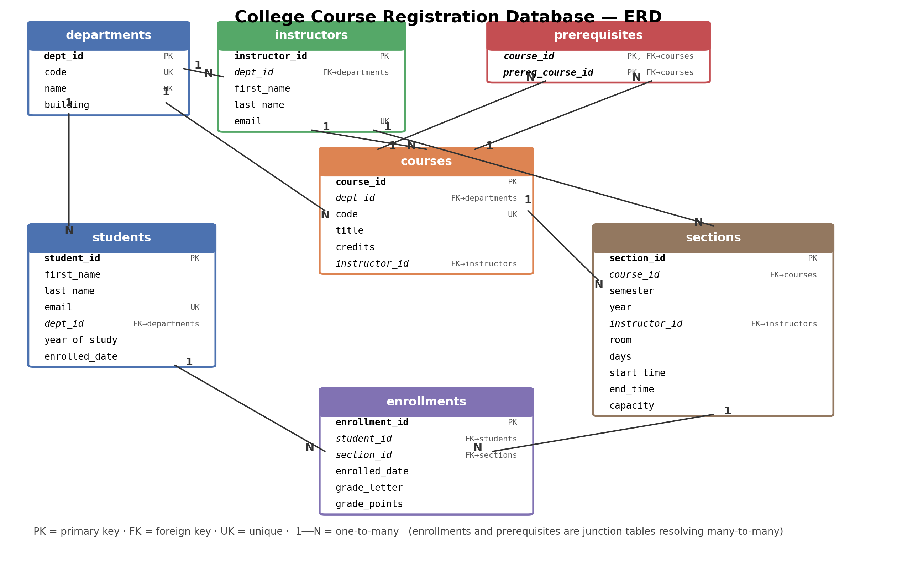

# 🎓 College Course Registration Database

**Designing and analysing a relational database in SQLite — from ERD to 20 SQL queries.**



👤 **Author:** Ahmed Abrar Tahseen · 📅 November 2026 · 🏷️ Project 4 of the GitHub Portfolio Project Pack (Database Analysis)

---

## 📌 The problem

Instead of downloading a database, we **design one** — that's what separates people who *use* databases from people who *understand* them. This project models a university course-registration system (students, departments, instructors, courses, prerequisites, sections, enrollments), draws the ER diagram, generates realistic synthetic data with Python, and answers 20 real registrar questions with SQL.

## 🗃️ Schema (7 tables, PK/FK constraints + a prerequisite-enforcing trigger)

<details>
<summary><b>registration.sql</b> (click to expand)</summary>

```sql
-- ============================================================================
-- registration.sql — College Course Registration Database (SQLite)
-- Project 4 · GitHub Portfolio Project Pack
--
-- Schema for a small university registration system:
--   departments, instructors, students, courses, prerequisites, sections,
--   enrollments (+ a trigger that enforces prerequisites on INSERT).
--
-- Run order:  sqlite3 registration.db < registration.sql
-- ============================================================================

PRAGMA foreign_keys = ON;   -- SQLite checks FOREIGN KEYs only when this is on

-- ----------------------------------------------------------------------------
-- 1. departments — one row per department (CSE, EEE, ...)
--    PRIMARY KEY (dept_id): every row is uniquely identified by this column.
--    UNIQUE (code, name): no two departments may share a code or a name.
-- ----------------------------------------------------------------------------
CREATE TABLE departments (
    dept_id   INTEGER PRIMARY KEY,          -- rowid alias: auto-incrementing id
    code      TEXT    NOT NULL UNIQUE,      -- short code, e.g. 'CSE'
    name      TEXT    NOT NULL UNIQUE,      -- full name, e.g. 'Computer Science'
    building  TEXT                          -- physical building
);

-- ----------------------------------------------------------------------------
-- 2. instructors — one row per teacher.
--    FOREIGN KEY (dept_id) -> departments(dept_id): an instructor must belong
--    to an existing department (referential integrity). One department has
--    MANY instructors  =>  one-to-many (1:N) relationship.
-- ----------------------------------------------------------------------------
CREATE TABLE instructors (
    instructor_id INTEGER PRIMARY KEY,
    dept_id       INTEGER NOT NULL REFERENCES departments(dept_id),
    first_name    TEXT    NOT NULL,
    last_name     TEXT    NOT NULL,
    email         TEXT    NOT NULL UNIQUE
);

-- ----------------------------------------------------------------------------
-- 3. students — one row per student.
--    FOREIGN KEY (dept_id) -> departments: a student declares one major dept.
--    CHECK (year_of_study BETWEEN 1 AND 5): only sane values are storable.
-- ----------------------------------------------------------------------------
CREATE TABLE students (
    student_id    INTEGER PRIMARY KEY,      -- university id, e.g. 2026001
    first_name    TEXT    NOT NULL,
    last_name     TEXT    NOT NULL,
    email         TEXT    NOT NULL UNIQUE,
    dept_id       INTEGER NOT NULL REFERENCES departments(dept_id),
    year_of_study INTEGER NOT NULL CHECK (year_of_study BETWEEN 1 AND 4),
    enrolled_date TEXT    NOT NULL          -- ISO date 'YYYY-MM-DD'
);

-- ----------------------------------------------------------------------------
-- 4. courses — the catalogue. Each course belongs to one department and has
--    one coordinating instructor (1:N from both sides).
-- ----------------------------------------------------------------------------
CREATE TABLE courses (
    course_id     INTEGER PRIMARY KEY,
    dept_id       INTEGER NOT NULL REFERENCES departments(dept_id),
    code          TEXT    NOT NULL UNIQUE,  -- e.g. 'CSE-201'
    title         TEXT    NOT NULL,
    credits       INTEGER NOT NULL CHECK (credits BETWEEN 1 AND 6),
    instructor_id INTEGER REFERENCES instructors(instructor_id)  -- coordinator
);

-- ----------------------------------------------------------------------------
-- 5. prerequisites — a course can require several other courses, and one
--    course can be the prerequisite of many courses. That is MANY-TO-MANY,
--    so it gets its own table with a composite PRIMARY KEY (course_id,
--    prereq_course_id). CHECK prevents a course from requiring itself.
-- ----------------------------------------------------------------------------
CREATE TABLE prerequisites (
    course_id        INTEGER NOT NULL REFERENCES courses(course_id),
    prereq_course_id INTEGER NOT NULL REFERENCES courses(course_id),
    PRIMARY KEY (course_id, prereq_course_id),
    CHECK (course_id <> prereq_course_id)
);

-- ----------------------------------------------------------------------------
-- 6. sections — a course is OFFERED as one or more sections in a semester
--    (the same course in Fall 2026 and Spring 2026 = two sections).
--    days/start_time/end_time let us detect overlapping time slots.
--    UNIQUE (course_id, semester, year, days, start_time): a course cannot be
--    offered twice in the same slot.
-- ----------------------------------------------------------------------------
CREATE TABLE sections (
    section_id    INTEGER PRIMARY KEY,
    course_id     INTEGER NOT NULL REFERENCES courses(course_id),
    semester      TEXT    NOT NULL CHECK (semester IN ('Fall','Spring','Summer')),
    year          INTEGER NOT NULL,
    instructor_id INTEGER NOT NULL REFERENCES instructors(instructor_id),
    room          TEXT    NOT NULL,
    days          TEXT    NOT NULL,         -- 'MWF', 'TTh', 'MW', 'T' ...
    start_time    TEXT    NOT NULL,         -- 'HH:MM' 24h
    end_time      TEXT    NOT NULL,
    capacity      INTEGER NOT NULL CHECK (capacity > 0),
    UNIQUE (course_id, semester, year, days, start_time)
);

-- ----------------------------------------------------------------------------
-- 7. enrollments — the JUNCTION TABLE between students and sections.
--    A student takes many sections; a section has many students => M:N,
--    resolved by this table. It also carries the grade (an attribute of the
--    relationship, not of either side).
--    UNIQUE (student_id, section_id): no double registration in one section.
-- ----------------------------------------------------------------------------
CREATE TABLE enrollments (
    enrollment_id INTEGER PRIMARY KEY,
    student_id    INTEGER NOT NULL REFERENCES students(student_id),
    section_id    INTEGER NOT NULL REFERENCES sections(section_id),
    enrolled_date TEXT    NOT NULL,
    grade_letter  TEXT CHECK (grade_letter IN
                  ('A+','A','A-','B+','B','B-','C+','C','C-','D','F','W')),
    grade_points  REAL CHECK (grade_points BETWEEN 0 AND 4)
    -- note: grade_points is NULL for 'W' (withdrawn)
);

-- ----------------------------------------------------------------------------
-- 8. STRETCH GOAL: enforceable rule — a student cannot register for a course
--    unless they have PASSED (grade_points >= 2.0, i.e. C or better) every
--    prerequisite in an EARLIER or the same semester.
--    SQLite enforces this with a TRIGGER: it runs BEFORE each INSERT on
--    enrollments and aborts the insert if a prerequisite is missing.
-- ----------------------------------------------------------------------------
CREATE TRIGGER enforce_prerequisites
BEFORE INSERT ON enrollments
BEGIN
    SELECT RAISE(ABORT, 'prerequisite not satisfied for this student')
    WHERE EXISTS (
        SELECT 1
        FROM prerequisites p
        JOIN sections s  ON s.section_id  = NEW.section_id   -- section being registered
        WHERE p.course_id = s.course_id                       -- its course
          AND NOT EXISTS (                                    -- student must have passed it
              SELECT 1
              FROM enrollments e
              JOIN sections s2 ON s2.section_id = e.section_id
              WHERE e.student_id    = NEW.student_id
                AND s2.course_id    = p.prereq_course_id
                AND e.grade_points >= 2.0
          )
    );
END;
```

</details>

**Relationship notes.** `departments → students/instructors/courses` are one-to-many (1:N).
`students ↔ sections` is many-to-many, resolved by the junction table `enrollments`
(which also carries the grade). `prerequisites` is a self-referencing many-to-many on `courses`
(composite PK). The trigger `enforce_prerequisites` **aborts any registration whose
prerequisite the student hasn't passed (grade_points ≥ 2.0)** — verified in `query_results.md`.

## 🔎 Three example queries (full set of 20 in `analysis_queries.sql`, outputs in `query_results.md`)

**Q03 — Top 10 students by CGPA (credit-weighted grade points):**

```sql
SELECT st.student_id, st.first_name || ' ' || st.last_name AS student, d.code AS dept,
       ROUND(SUM(e.grade_points * c.credits) / SUM(c.credits), 2) AS cgpa,
       SUM(c.credits) AS credits_taken
FROM students st
JOIN enrollments e ON e.student_id = st.student_id
JOIN sections s    ON s.section_id = e.section_id
JOIN courses c     ON c.course_id  = s.course_id
JOIN departments d ON d.dept_id    = st.dept_id
WHERE e.grade_points IS NOT NULL
GROUP BY st.student_id
HAVING SUM(c.credits) >= 12
ORDER BY cgpa DESC LIMIT 10;
```

| student_id | student | dept | cgpa | credits_taken |
|---|---|---|---|---|
| 2026472 | Amy Levine | CSE | 3.62 | 17 |
| 2026341 | Elizabeth Hodge | CSE | 3.56 | 26 |
| 2026418 | James Cruz | PHY | 3.55 | 30 |
| 2026429 | Dana Oliver | MAT | 3.5 | 24 |
| 2026070 | Yvette Huff | CSE | 3.49 | 34 |

**Q04 — Courses with the highest failure rates** (CASE + HAVING):

| code | title | enrollments | failures | fail_rate_pct |
|---|---|---|---|---|
| ARC-301 | Structural Systems | 34 | 3 | 8.8 |
| ECO-201 | Macroeconomics | 94 | 8 | 8.5 |
| CHE-201 | Organic Chemistry | 136 | 8 | 5.9 |

**Q05 — Semester-over-semester enrollment growth** (window function LAG):

| semester | enrollments | change_vs_prev |
|---|---|---|
| Fall 2025 | 1404 | 1404 |
| Spring 2026 | 1645 | 241 |
| Fall 2026 | 1951 | 306 |

## 🧠 Technique coverage across the 20 queries

| Technique | Queries |
|---|---|
| JOIN (multi-table) | Q01–Q09, Q12, Q14–Q20 |
| GROUP BY + aggregates | almost all |
| HAVING | Q02, Q04, Q15, Q16 |
| Subqueries (NOT EXISTS / correlated / CTE) | Q08, Q10 |
| CASE (conditional counting/aggregation) | Q04, Q11, Q13, Q20 |
| Window functions (LAG, RANK, SUM OVER) | Q05, Q11, Q19 |
| Self-JOIN | Q07 (overlaps), Q17 (retakes) |
| Views | `current_semester_transcript`, `department_performance` (`views.sql`) |
| Trigger (enforceable rule) | `enforce_prerequisites` in `registration.sql` |

## 📋 Findings for the registrar

See [`INSIGHTS.md`](INSIGHTS.md): enrollment growing +17%/+19% per semester; CSE-101 sections all at 100% fill; failure risk concentrated in ARC-301/ECO-201/CHE-201; 13 students double-booked in overlapping sections; MAT/ENG grade drift vs Fall 2025.

## ▶️ How to run

```bash
git clone https://github.com/tahseen017/course-registration-db.git
cd course-registration-db
pip install -r requirements.txt

# rebuild the database from scratch (optional — registration.db is committed)
sqlite3 registration.db < registration.sql      # create schema
python seed_data.py                            # insert synthetic data -> registration.db
sqlite3 registration.db < views.sql            # create the 2 views

# run all 20 analysis queries and regenerate query_results.md
python run_analysis.py

# or explore interactively
sqlite3 registration.db
sqlite> SELECT * FROM department_performance ORDER BY avg_cgpa DESC;
```

## 🗂️ Project structure

```
course-registration-db/
├── registration.sql        # schema: 7 tables, PK/FK/CHECK/UNIQUE + prerequisite trigger
├── erd.png                 # ER diagram (hero image) — regenerated by make_erd.py
├── seed_data.py            # synthetic data generator (Faker, seed=42)
├── registration.db         # the generated SQLite database (committed)
├── analysis_queries.sql    # 20 commented queries, each labelled with its technique
├── run_analysis.py         # executes all queries -> query_results.md (+ trigger demo)
├── query_results.md        # auto-generated outputs of all 20 queries
├── views.sql               # current_semester_transcript, department_performance
├── INSIGHTS.md             # one-page registrar memo (5 findings)
├── make_erd.py             # draws erd.png with matplotlib
├── requirements.txt
└── README.md
```

## 📊 Data

Self-generated synthetic data (no download): 10 departments, 30 instructors, 500 students, 40 courses (+31 prerequisites), 195 sections across Fall 2025 / Spring 2026 / Fall 2026, **5,000 graded enrollments**. Deterministic (seed 42).

## 💼 CV bullet (once pushed)

> Designed and analysed a relational course-registration database in SQLite — ERD, constraints, views and 20 SQL analysis queries.

## 📄 License

MIT License (code). The database content is synthetic and free to use.
